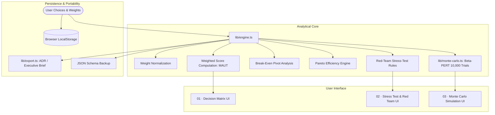

# ReasonGraph

A local-first decision-intelligence workbench for consequential trade-offs and robust choices.

Most important choices—career moves, tech stack architecture, vendor contracts, hiring offers—are decided either through simplistic pros/cons lists or emotional gut feeling. ReasonGraph provides a structured, mathematically sound environment to make priorities explicit, score evidence objectively, and stress-test assumptions before committing.

Operates **100% locally in the browser**. No external APIs, no paid subscriptions, no cloud tracking, zero telemetry.

---

## Why ReasonGraph?

Decision-making literature (specifically **Multi-Attribute Utility Theory / MAUT** and **Epistemic Decision Hygiene**) demonstrates that human decision-makers systematically fall into three traps:

1. **Proxy bias**: Overweighting criteria that are easy to measure (e.g. salary, GitHub stars) over criteria that actually matter (e.g. learning rate, operational overhead).
2. **Fragile conviction**: Mistaking a narrow lead for a decisive mandate without testing how sensitive the result is to minor estimation errors.
3. **Hidden single points of failure**: Failing to isolate the single pivot variable that could flip the entire outcome.

ReasonGraph tackles these directly by separating **values** (weights) from **evidence** (scores), and running an automated **Red Team Stress-Test** over the model.

---

## Key Features

- **Weighted Decision Matrix**: Score competing options against customizable criteria with single-click proportional weight normalization.
- **Dynamic Proportional Auto-Balancing**: Optional slider mode that strictly conserves the invariant $\sum W_i = 100\%$ live on every drag by scaling all other criteria proportionally.
- **Full Dynamic Sensitivity Grid**: Analyzes breaking point thresholds across *every* criterion against the top-3 contenders simultaneously (#1 vs #2 and #1 vs #3).
- **Multi-Metric Gradient Vector Sensitivity**: Calculates the shortest Euclidean distance $\|\vec{\Delta}^*\|_2$ to the decision hyperplane to measure vulnerability when multiple criteria drift collectively.
- **Monte Carlo Probabilistic Simulation Engine**:
  - Simulates 10,000 alternate futures using continuous **Beta-PERT probability distributions** ($a$: pessimistic, $m$: most likely, $b$: optimistic).
  - Quantifies **True Win Probability** (e.g. Option A wins in 68.4% of simulated futures).
  - Computes **Percentile Spreads** (P10 bear case, P50 median, P90 bull case).
  - Evaluates **Value-at-Risk (VaR 95%)** to measure exposure to catastrophic downside tails.
  - Renders **Interactive Overlapping SVG Probability Density Curves**.
- **Break-Even Sensitivity Analysis**: Calculates the exact point delta ($\Delta$) required on each criterion for the runner-up to bridge the margin and overturn the leader.
- **Dynamic Red-Team Stress Test**:
  - **Multi-Metric Fragility Alert**: Warns when small simultaneous drifts across multiple criteria collectively dethrone the leader.
  - **Probabilistic Inversion Alert**: Flags scenarios where the deterministic leader has a lower probability of winning due to extreme volatility.
  - **Lead Fragility Indicator**: Highlights when a leader holds a fragile victory margin (< 0.6 pts) versus a robust advantage.
  - **Single Point of Failure (SPOF)**: Identifies which criterion carries the highest decision leverage.
  - **Pareto Dominance Detector**: Flags strictly inferior options that can be safely eliminated.
  - **Underweighted Blindspot Finder**: Spots criteria where options diverge sharply in performance but have been assigned disproportionately low weights.
- **Epistemic Confidence Slider**: Adjust between speculative predictions (20%) and verified observations (95%) to discount lead scores under uncertainty.
- **Local Persistence & Export**:
  - Autosaves state in browser `localStorage`.
  - Export and Import decision states via structured JSON.
  - One-click **Executive Brief Export** (generates clean GitHub-flavored Markdown memos / ADRs ready to paste into Notion, GitHub Discussions, or Slack).
- **Pre-Built Decision Templates**:
  - 🎓 *Career Path Optimization* (Seed-stage startup vs. BigTech vs. Bootstrapping)
  - 🏗️ *Database Architecture* (PostgreSQL vs. Amazon DynamoDB vs. MongoDB)
  - ☁️ *Cloud Strategy* (Serverless vs. Containerized Kubernetes vs. Modular Monolith)

---

## Architecture



---

## Getting Started

### Prerequisites
- Node.js 20+
- npm or pnpm

### Installation

1. Clone the repository:
```bash
git clone https://github.com/MafiaCatto/ReasonGraph.git
cd ReasonGraph
```

2. Install dependencies:
```bash
npm install
```

3. Run the development server:
```bash
npm run dev
```

Open [http://localhost:3000](http://localhost:3000) in your browser.

### Running Tests

ReasonGraph includes a comprehensive unit test suite covering weight normalization, score rankings, break-even math, Pareto dominance detection, Beta-PERT random variates, and Monte Carlo probability distributions:

```bash
npm test
```

### Production Build

```bash
npm run build
npm start
```

---

## Decision Theory & Mathematical Foundation

### 1. Multi-Attribute Utility Score (MAUT)
$$\text{Score}(O_j) = \frac{\sum_{i=1}^{n} s_{ij} \cdot w_i}{\sum_{i=1}^{n} w_i}$$
where $s_{ij} \in [1, 10]$ is the score of option $j$ on criterion $i$, and $w_i \in [0, 100]$ is the criterion weight.

### 2. Break-Even Pivot Delta
$$\Delta_{i} = \frac{\text{Margin} \times 100}{w_i}$$
representing the single-variable score increase the runner-up requires on criterion $i$ to tie the leading option.

### 3. Beta-PERT Probability Density Sampling
For 3-point estimates with pessimistic bound $a$, mode $m$, and optimistic bound $b$:
- **Expected Value**: $\mu = \frac{a + 4m + b}{6}$
- **Variance**: $\sigma^2 = \frac{(b - a)^2}{36}$
- **Beta Shape Parameters**:
  $$\alpha = 1 + 4 \cdot \frac{m - a}{b - a}, \quad \beta = 1 + 4 \cdot \frac{b - m}{b - a}$$
- **Simulated Win Probability**:
  $$P(\text{Win}_j) = \frac{1}{N} \sum_{k=1}^{N} \mathbb{I}\left(T_j^{(k)} = \max_{r} T_r^{(k)}\right)$$
  where $N = 10{,}000$ independent trials and $T_j^{(k)}$ is the weighted composite utility in simulation trial $k$.

### 4. Value-at-Risk (VaR at 95%)
$$\text{VaR}_{0.95}(O_j) = \inf \{ t \in \mathbb{R} : P(T_j \le t) \ge 0.05 \}$$
representing the 5th-percentile downside outcome below which only 5% of simulated futures fall.

### 5. Multi-Metric Hyperplane Distance & Shortest Reversal Vector
When multiple criteria drift simultaneously, the boundary where Option R (runner-up) overtakes Option L (leader) forms an $(n-1)$-dimensional decision hyperplane:
$$\text{Margin} + \sum_{i=1}^n \Delta_i \cdot (S_{L,i} - S_{R,i}) = 0$$

Let $\vec{D} = [S_{L,1} - S_{R,1}, \dots, S_{L,n} - S_{R,n}]$ be the score difference vector across all $n$ criteria. The shortest Euclidean perturbation vector $\vec{\Delta}^*$ required to cross this decision boundary is:
$$\vec{\Delta}^* = -\text{Margin} \cdot \frac{\vec{D}}{\|\vec{D}\|_2^2}$$

The shortest Euclidean distance from the current evaluation to the decision reversal boundary is:
$$d^* = \|\vec{\Delta}^*\|_2 = \frac{\text{Margin}}{\sqrt{\sum_{k=1}^n (S_{L,k} - S_{R,k})^2}}$$

A small $d^* < 0.25$ indicates **High Systemic Fragility**, meaning minor correlated slippage across multiple criteria will overturn the decision even if no single criterion reaches its individual 1D break-even threshold.

---

## ⚖️ System Limitations & Architectural Trade-offs

A core engineering principle behind ReasonGraph is balancing **mathematical fidelity** against **cognitive friction**. During the design phase, an important architectural choice was made regarding criteria independence.

### 1. The Independence Assumption (v1 Design Decision)
Standard Multi-Attribute Utility Theory (MAUT) assumes that criteria are **mutually preference-independent**. In ReasonGraph v1, each criterion is evaluated as an orthogonal dimension:

$$\text{Cov}(S_i, S_j) = 0 \quad \forall \; i \ne j$$

#### Why this was chosen for v1:
- **Low Cognitive Friction**: The primary failure mode of decision tools is user abandonment. Forcing users to define joint probability distributions, conditional probability tables (CPTs), or draw complex node networks before getting an answer creates massive input fatigue.
- **Sub-25ms Simulation Performance**: Sampling independent Beta-PERT variates allows pre-allocated `Float32Array` buffers to complete 10,000 trials in $<25\text{ ms}$ on a single thread without blocking UI interaction or requiring heavy WebAssembly runtimes.

---

### 2. The Real-World Limitation: Conditional Dependencies
In consequential real-world decisions, criteria are rarely fully independent. For example, in an infrastructure decision:
- An option scoring high in **Architectural Complexity** will almost certainly drive up **Operational Overhead**.
- Increased **Operational Overhead** directly degrades **Financial Runway** and **Time to Market**.

Treating them as orthogonal can underestimate tail risk if multiple negatively correlated variables degrade simultaneously.

---

### 3. Proposed v2 Architecture: Directed Acyclic Graph (DAG) Layer

To model cascading risk without compromising user experience, the planned v2 architecture introduces an optional **Causal Graph Layer**:


#### Graph Formulation & Kahn's Algorithm (Topological Sort)
Let $G = (V, E)$ be a directed graph where vertices $V$ represent criteria, and directed edges $(u, v) \in E$ represent causal influence with weight $\beta_{uv} \in [-1, 1]$.

To evaluate cascading effects in order, the graph must be a **DAG** (no circular dependencies like $A \to B \to A$). We apply **Kahn's Algorithm** for topological ordering and cycle detection:

```typescript
function getTopologicalOrder(criteria: Criterion[], edges: CausalEdge[]): string[] {
  const inDegree = new Map<string, number>();
  const adj = new Map<string, string[]>();

  for (const c of criteria) {
    inDegree.set(c.id, 0);
    adj.set(c.id, []);
  }

  for (const { from, to } of edges) {
    adj.get(from)?.push(to);
    inDegree.set(to, (inDegree.get(to) ?? 0) + 1);
  }

  // Queue nodes with in-degree 0 (independent root variables)
  const queue: string[] = [];
  for (const [id, deg] of inDegree.entries()) {
    if (deg === 0) queue.push(id);
  }

  const order: string[] = [];
  while (queue.length > 0) {
    const node = queue.shift()!;
    order.push(node);

    for (const neighbor of adj.get(node) ?? []) {
      const nextDeg = (inDegree.get(neighbor) ?? 1) - 1;
      inDegree.set(neighbor, nextDeg);
      if (nextDeg === 0) queue.push(neighbor);
    }
  }

  // Cycle detection: if order length doesn't match total vertices, a cycle exists
  if (order.length !== criteria.length) {
    throw new Error("CycleDetectedError: Circular dependency found in causal graph.");
  }

  return order;
}
```

#### The Mathematical Hurdle: Covariance vs. The Iman-Conover Method
A naive implementation would simply compute downstream scores using linear scalar shifts:
$$S_v = S_v + \beta_{uv} \cdot (S_u - \mu_u)$$

**Why naive scalar propagation fails mathematically:**
1. It distorts the defined $[1, 10]$ boundaries of the distribution.
2. It destroys the Beta-PERT probability density curve, turning a carefully modeled bounded estimate into an arbitrary skewed distribution.

**The Mathematically Rigorous Solution (Planned for v2):**
To induce rank correlation between non-normal distributions without altering their marginal distributions, v2 will implement the **Iman-Conover Method (1982)**:
1. Generate an independent sample matrix $\mathbf{X}_{N \times n}$ where each column follows its respective Beta-PERT distribution.
2. Construct the desired correlation matrix $\mathbf{C}$ from the DAG edges and factor it using **Cholesky Decomposition**: $\mathbf{C} = \mathbf{L}\mathbf{L}^T$.
3. Transform a set of standard normal scores by $\mathbf{L}$ to induce the target correlation structure.
4. Reorder the original Beta-PERT sample values to match the rank order of the correlated normal scores, exactly preserving each variable's marginal Beta-PERT distribution while honoring the DAG dependencies.

---

### 4. Engineering Summary
By shipping v1 with **MAUT + Beta-PERT Monte Carlo**, ReasonGraph delivers immediate, bounded risk modeling without cognitive fatigue. The DAG architecture is formally specified for v2 as an opt-in mode for advanced quantitative modeling.

---

## License

MIT
